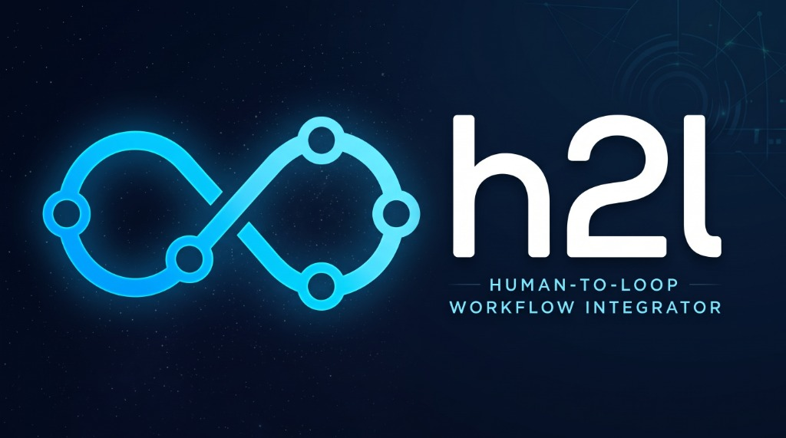

<p align="center">
  
</p>

# h2l — Human-to-Loop Workflow Integrator

**h2l** is a self-hosted B2B Human-in-the-Loop platform for workflow engines (**Camunda 8 / Zeebe**, **n8n**, and generic webhooks). It lets teams pause automated workflows for human decisions, approvals, and data entry without building custom form portals from scratch.

- **Drag-and-Drop Form Builder** — design versioned forms with conditional logic, sensitive-field encryption (AES-256-GCM), and workflow variable mapping.
- **End-User Task Portal (PWA)** — responsive Angular Progressive Web App with offline draft support, **EN / DE / PL** localization, and **WCAG 2.1 AA** accessibility.
- **Privacy by Default** — sensitive fields stay encrypted in `h2l` and are referenced via the Claim-Check pattern instead of leaking into workflow execution logs.

---

## Quickstart (`docker run`)

Run the all-in-one container with embedded PostgreSQL 17 and persistent storage on `/data`:

```bash
docker run -d \
  --name h2l \
  -p 8080:8080 \
  -v h2l_data:/data \
  -e JWT_SIGNING_KEY="$(openssl rand -base64 32)" \
  -e ENCRYPTION_AES_GCM_KEY="$(openssl rand -base64 32)" \
  ghcr.io/dariuszkusz/h2l:latest
```

Open **http://localhost:8080** in your browser. When `DB_CONNECTION_STRING` is omitted, the container initializes an embedded PostgreSQL 17 instance inside `/data/postgres` and applies schema migrations automatically.

---

## Production Deployment (`docker-compose.yml`)

For production deployments, run `h2l` with an external PostgreSQL 17 container and optional automatic HTTPS via Caddy:

1. Create `.env` from the template and fill in strong secrets (`POSTGRES_PASSWORD`, `JWT_SIGNING_KEY`, `ENCRYPTION_AES_GCM_KEY`):

```bash
cp .env.example .env
```

2. Start `h2l` and PostgreSQL:

```bash
docker compose up -d
```

3. Optional — enable automatic HTTPS reverse proxy with Caddy:

```bash
H2L_DOMAIN=h2l.example.com docker compose --profile https up -d
```

> **Database Migrations:** `docker-compose.yml` defaults to `DB_AUTO_MIGRATE=false` so production upgrades can apply schema changes safely with the EF Core Migration Bundle before starting new replicas. For a single-instance deployment, set `DB_AUTO_MIGRATE=true` in `.env`.

---

## Backup & Restore (PostgreSQL)

Use the included helper script to create compressed `pg_dump` archives with SHA-256 checksums and automatic retention cleanup (`BACKUP_RETENTION_DAYS`, default `30` days):

```bash
# Create a backup in ./backups
./scripts/backup-postgres.sh backup

# Restore from a backup archive
./scripts/backup-postgres.sh restore ./backups/h2l-h2l-YYYYMMDDTHHMMSSZ.dump
```

---

## n8n Community Node (`n8n-nodes-h2l`)

`h2l` ships with an official n8n Community Node in [`integrations/n8n-nodes-h2l/`](integrations/n8n-nodes-h2l/) that supports:

- **Create & Wait for Form** — pauses an n8n workflow using `$execution.resumeUrl`, assigns a human task in `h2l`, and resumes automatically upon submission.
- **Get Sensitive Data (Claim-Check)** — fetches encrypted sensitive fields on demand with full audit logging.

---

## Repository Structure

- [`backend/`](backend/) — .NET 10 Web API (Clean Architecture, CQRS, UnitOfWork, EF Core + PostgreSQL, Quartz.NET, SignalR, OpenTelemetry)
- [`frontend/`](frontend/) — Angular PWA (NgRx, Tailwind CSS, WCAG 2.1 AA, EN/DE/PL i18n, Cypress)
- [`integrations/n8n-nodes-h2l/`](integrations/n8n-nodes-h2l/) — Official n8n Community Node package
- [`docker/`](docker/) & [`scripts/`](scripts/) — Container entrypoint, Caddy HTTPS configuration, and PostgreSQL backup/restore utilities
